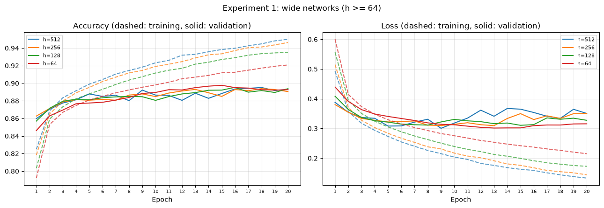
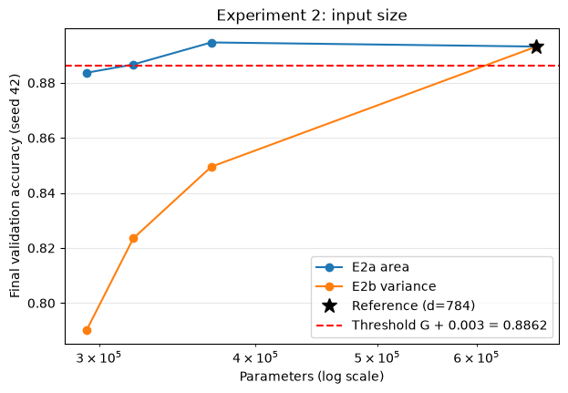
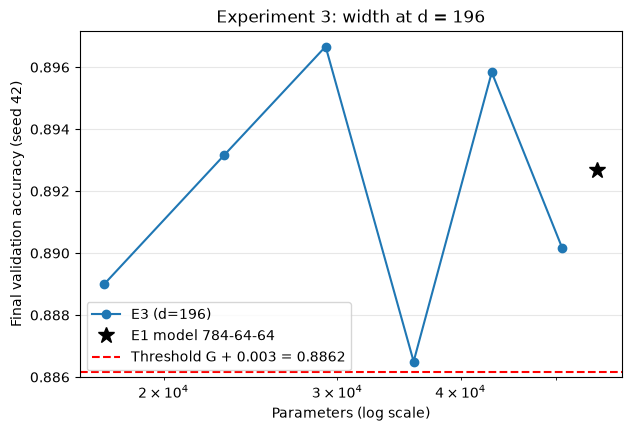
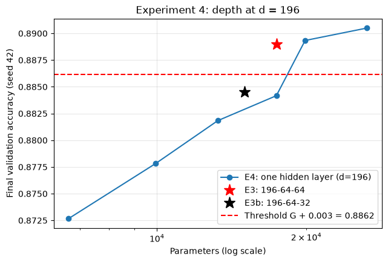

% Lean Network Challenge: how small can a fully connected network be on Fashion-MNIST?
% Jesús Inurria
% 22/11/2026

# 1. Introduction

The challenge asks for the fully connected network (MLP) with the fewest parameters whose mean test accuracy over three seeds is within one percentage point of a fixed reference model. I use **Fashion-MNIST** (28x28 grayscale images, 10 classes, 60,000 training and 10,000 test images). It has the format of MNIST but is harder: a plain MLP does not saturate near 100 %, so accuracy visibly degrades as the network shrinks and the size/accuracy trade-off can be measured. It is also small enough to train many MLPs quickly.

**Reference model.** Two hidden layers of 512 ReLU units, Adam (learning rate 1e-3), 20 epochs, batch size 128, seed 42: 669,706 parameters (counted with `model.count_params()`), test accuracy **0.8833**. The official target is therefore a mean test accuracy of at least **0.8733** over three seeds. The reference cell is unchanged from the template and is trained once. 60.0 % of its parameters (401,920) are in the first layer (784 x 512 + 512) and 39.2 % in the 512 x 512 layer. Its curves show a high-variance pattern: training accuracy reaches 0.9500 while validation accuracy plateaus around 0.89, and validation loss reaches its minimum (0.3006) at epoch 9 and then rises to 0.3506. The train-validation gap is 5.7 pp, so the network has more capacity than the task needs.

# 2. Experimental design

**Fair use of data.** Validation is 10 % of the training set (6,000 images, seed 42). Every design decision uses validation only. The test set is used only for the reference and for the pre-committed final lean model.

**Validation guide G.** G = final-epoch validation accuracy of the reference − 0.01 = 0.8832; decision threshold G + 0.003 = 0.8862. We use the final epoch (epoch 20) for both the reference and the candidates so that they are compared on the same quantity. Candidates are averaged over seeds; a candidate passes only if its 3-seed mean reaches the threshold, and the 0.3 pp margin guards against seed noise.

**Common training protocol.** ReLU, Adam 1e-3, 20 epochs, batch size 128, no early stopping, no regularisation, unless that is the factor under study. Seeds are set with `keras.utils.set_random_seed` before building each model. Every trained model is stored with `record(...)`.

**Seed protocol (D5).** Each architecture family is first screened with seed 42. Starting from the largest size that fails below the smallest one that passes, sizes are also trained with seeds 7 and 126 in ascending order, and the smallest size whose 3-seed mean (42/7/126) is at least 0.8862 is chosen. Networks needed for a key comparison (for example equal-budget pairs) are always trained with all three seeds. The aim is not to choose a network because seed 42 happened to be lucky.

**Experiments (one factor at a time).** E1 width (784-h-h-10); E2 input size and compression method, with the 512-512 network; E3 width at the reduced input (combining E1 and E2); E3b width of the second layer only; E4 one hidden layer (depth); E4b three and four narrow hidden layers; E5 optimiser x regularisation on the networks that failed narrowly. E1-E4b are *architecture* experiments (smaller networks trained from scratch, not pruning); E5 is a *training-improvement* experiment with fixed architecture. From E3 on, each experiment starts from the previous model.

**Protocol notes.** I wrote the hypothesis before running each experiment. The best failing E4b network, 196-48-48-48, is used as a second E5 candidate (D13). The main run is the local CPU execution; a second, complete run on Google Colab (GPU T4) is compared in Section 6.

# 3. Results and analysis

All accuracies are **validation** accuracies at epoch 20 unless stated otherwise; no test number is used for any decision. "Pass" means 3-seed mean >= 0.8862. Table 1 summarises the experiments and Figure 5 shows every trained model.

| Exp. | Factor varied | Smallest passing network | Parameters | Val. mean (3 seeds) |
|---|---|---|---|---|
| Ref. | (512-512, input 784) | reference, one seed | 669,706 | 0.8932 (seed 42) |
| E1 | width | 784-64-64 | 55,050 | 0.8899 |
| E2 | input size (area averaging) | 196-512-512 | 368,650 | 0.8942 |
| E3 | width at d = 196 | **196-64-64** | **17,418** | **0.8873** |
| E3b | 2nd layer 64 to 32 | none (196-64-32, 15,018) | – | 0.8834 (fails) |
| E4 | one hidden layer | 196-128 (196-84 fails) | 26,506 | 0.8876 |
| E4b | 3 or 4 narrow layers | none | – | best 0.8834 (fails) |
| E5 | optimiser x regularisation | none rescues the candidates | – | best 0.8847 (fails) |

*Table 1. Outcome of each experiment (validation only). The smallest network that passes the 0.8862 threshold is 196-64-64.*

## 3.1 Experiment 1: width

**Hypothesis.** The reference overfits, so a much narrower network should lose little accuracy. **Design.** Width of both hidden layers halved from 256 down to 8; input 784 and everything else fixed.

**Result.** Validation accuracy stays near 0.89 down to h = 64 (0.8927, seed 42) and then drops: 0.8853 (h = 32), 0.8705 (16), 0.8532 (8). The train-validation gap falls monotonically from 0.0568 (h = 512) to 0.0086 (h = 8). With seeds 7 and 126, h = 32 gets a mean of 0.8818 (fails, so bad luck with seed 42 is rejected) and h = 64 a mean of 0.8899 (passes: 55,050 parameters, 12.2 times fewer than the reference). Seed 42 was the best of the three seeds for h = 64 (0.8927 against 0.8860 and 0.8912), which is why decisions use means.

**Why.** This is the passage from overfitting to underfitting (Figure 1). Wide networks have high variance: training loss keeps falling while validation loss rises after epoch 9. Narrow networks have high bias: for h = 16 and 8 the minimum validation loss is at the last epoch, so they are capacity-limited. Most of the reference capacity was unnecessary, but with a 784-dimensional input the floor is about 55,000 parameters, because the first layer (784 x h) holds 91 % of the weights.

## 3.2 Experiment 2: input size

**Hypothesis.** Neighbouring pixels are correlated and border pixels are almost constant, so the input is redundant. Averaging neighbours (a low-pass filter) should keep more information than selecting the highest-variance pixels. **Design.** With the 512-512 network fixed, reduce the input to d = 196, 100, 49 by area averaging (14x14, 10x10, 7x7) or by keeping the d highest-variance pixels (variance computed on training images only).

**Result.** With averaging, d = 196 passes (mean 0.8942, 368,650 parameters); d = 100 passes with seed 42 (0.8867) but fails with three seeds (mean 0.8851); d = 49 fails (0.8811). Selection by variance is much worse at equal parameters: d = 196 gets a mean of 0.8530 (4.1 pp below averaging), and d = 100 and d = 49 get 0.8235 and 0.7903 (seed 42), so only d = 784 passes (Figure 2). The best saving is 45 % (368,650 against 669,706 parameters), far below E1.

**Why.** High variance is not class information. The highest-variance pixels lie on the silhouette (sleeves, neck, hem), which depends on the shape and position of each garment, while the low-variance interior carries the texture that separates similar classes. Selection also widens the gap (0.0661-0.0770 against 0.0568), so the problem is lost information and not capacity. Averaging keeps a summary of every pixel and lowers the gap (0.0568 to 0.0228 at d = 49). With 512-512 the 512 x 512 block (262,656 parameters) dominates, so parameters cannot fall below 268,298 by shrinking the input alone: the two factors only combine once the width is also reduced.

## 3.3 Experiment 3: width at d = 196 (combining E1 and E2)

**Hypothesis.** With a narrow network the first layer weighs most (91 % at 784-64-64), so reducing the input should now help a lot; but the savings need not add up, so I predicted that h = 64 would no longer be enough. **Design.** Input 14x14 by averaging, h in {64, 80, 96, 112, 128, 144}.

**Result.** The prediction is refuted: 196-64-64 (17,418 parameters) passes with a 3-seed mean of 0.8873 (0.8890, 0.8863, 0.8865). The margin over the threshold is only 0.0011, and the mean is 0.26 pp below that of 784-64-64 (0.8899). The gap falls from 0.0281 to 0.0062 (seed 42), so the network is close to its capacity limit. Wider networks (up to 144) are not clearly better: the seed-42 accuracies (0.8865-0.8967) follow no order, which I attribute to single-seed noise.

**Why.** Reducing the input cuts the first layer from 50,240 to 12,608 parameters, and the whole network is 38 times smaller than the reference. The information removed by averaging is redundant even for a narrow network, the same conclusion as E2 seen from the other side: the saving comes from the input x width product of the first layer. I did not test h < 64 at d = 196 with two equal layers, so I do not know whether a smaller network of that form would also pass.

## 3.4 Experiments 3b and 4: second-layer width and depth

**E3b (hypothesis and result).** Halving only the second layer (196-64-32, 15,018 parameters, 14 % fewer) should cost little accuracy. The 3-seed mean falls to 0.8834 (0.28 pp below the threshold; fails), and it is below E3 in all three seeds (0.8845, 0.8810, 0.8847 against 0.8890, 0.8863, 0.8865). The seed-to-seed ranges (0.0027 for E3, 0.0037 for E3b) are of the same order as the difference of means (0.0039), so on its own the result does not prove a real loss. With seed 42 the training accuracy also drops (0.8952 to 0.8896), which is consistent with underfitting.

**E4 (hypothesis).** At equal budget depth is more parameter-efficient than width: a one-hidden-layer ReLU network can approximate any continuous function (universal approximation) but may need many neurons, whereas depth composes non-linear features. Predictions: 196-84 (17,398 parameters) is worse than 196-64-64, and no one-layer network below 17,418 parameters passes. **Result.** Both hold. 196-84 gets 0.8823 against 0.8873 (-0.50 pp) and is worse in all three seeds. The smallest passing one-layer network is 196-128 (26,506 parameters, mean 0.8876): 52 % more parameters for the same accuracy. One-layer gaps are between -0.0009 and 0.0044, so these networks are limited by capacity (Figure 4).

## 3.5 Experiment 4b: three and four narrow layers (hypothesis refuted)

**Hypothesis.** Following E4, more and narrower layers should match or beat 196-64-64 at equal budget, and some network with fewer than 17,418 parameters should pass. **Design.** Equal widths; three layers with h in {32, 40, 48, 54} (8,746-17,128 parameters) and four layers with h in {32, 40, 48} (9,802-17,002).

**Result.** No network with three or four hidden layers passes. At nearly equal budget, 196-54-54-54 (17,128 parameters) gets a mean of 0.8822 and 196-48-48-48-48 (17,002) gets 0.8786: 0.51 and 0.87 pp below 196-64-64. All their individual seeds are below the worst seed of 196-64-64 (0.8863). 196-48-48-48 passes with seed 42 (0.8862) but not with three seeds (0.8834).

**Why.** I had expected narrow deep networks to converge slowly and lose training accuracy. The opposite happens: their training accuracy is equal or higher (0.8969 and 0.8970 against 0.8958) and the gap grows from 0.0085 to 0.0148 and 0.0185. Adding a fourth layer of 48 raises training accuracy (0.8937 to 0.8970) and lowers validation accuracy (0.8834 to 0.8786). My reading is that extra depth fits the training set without generalising, perhaps because splitting the budget narrows the first layer, which sees the 196 inputs, from 64 to 54 or 48 units. I did not measure this directly, and E5 weakens it (regularisation does not help 196-48-48-48), so it remains a hypothesis. Together with E4, the evidence indicates that two hidden layers work best at about 17,400 parameters.

## 3.6 Experiment 5: optimiser and regularisation

**Hypothesis (before running).** The small networks hardly overfit (gaps 0.005-0.010), so regularisation should help little or hurt; the effect should be worse for the smaller network; L1 should be the most harmful. **Design.** Architecture fixed at d = 196. Rule D8 picked the network with the highest mean among those that fail and are smaller than the winner: 196-64-32. Grid: Adam 1e-3, RMSprop 1e-3 and SGD with momentum 0.9 at 1e-2, each with no regularisation, Dropout 0.1, L1 1e-5 and L2 1e-4 on the hidden layers, plus a block with the learning rate multiplied by 3 (no regularisation); seeds 42, 7, 126. The same grid was also applied to 196-48-48-48 (14,650 parameters; mean 0.883444 against 0.883389 for 196-64-32). The grid was also run on the winner for information.

**Result.** No recipe rescues either candidate (Table 2). The closest are Adam with Dropout on 196-64-32 (0.8847, 0.0015 below the threshold) and Adam with L2 on 196-48-48-48 (0.8842, 0.0019 below). On the winner, most regularised variants are below the control; Adam with Dropout also passes (0.8863), with the same parameters and a mean 0.0010 lower than the control. A rescue would have saved only 2,400 (13.8 %) or 2,768 (15.9 %) parameters.

| Recipe (3-seed val. mean) | 196-64-64 (17,418) | 196-64-32 (15,018) | 196-48-48-48 (14,650) |
|---|---|---|---|
| Adam 1e-3, no reg. (control) | **0.8873** | 0.8834 | 0.8834 |
| Adam 1e-3 + Dropout 0.1 | 0.8863 | 0.8847 | 0.8813 |
| Adam 1e-3 + L1 1e-5 | 0.8841 | 0.8842 | 0.8830 |
| Adam 1e-3 + L2 1e-4 | 0.8830 | 0.8825 | 0.8842 |
| RMSprop 1e-3, no reg. | 0.8802 | 0.8749 | 0.8742 |
| SGD + momentum 1e-2, no reg. | 0.8775 | 0.8768 | 0.8794 |
| Adam 3e-3, no reg. | 0.8853 | 0.8821 | 0.8828 |
| RMSprop 3e-3, no reg. | 0.8728 | 0.8729 | 0.8691 |
| SGD + momentum 3e-2, no reg. | 0.8812 | 0.8802 | 0.8793 |

*Table 2. Experiment 5: 3-seed validation means (threshold 0.8862). Selected rows of the grid; RMSprop and SGD were also run with Dropout, L1 and L2 (all 15 recipes are in the notebook), and none passes.*

**Why.** Adam 1e-3 was already the best optimiser without regularisation: SGD is 0.4-1.0 pp lower (and still improving at epoch 20 in seed 42, so 20 epochs favour Adam), and RMSprop is unstable between seeds. Regularisation constrains a network that lacks capacity instead of one that has too much, as the small gaps show. Higher learning rates raise the training accuracy (Adam 3e-3 reaches 0.9059 on the winner) without improving validation. Differences between recipes are mostly of the size of the seed standard deviation (0.001-0.013), so I only claim the overall pattern: none of these levers changes the number of parameters or the weight of the first layer, and none recovers the capacity lost between 196-64-64 and its candidates (0.0039 in mean validation accuracy). With 28 recipe-candidate pairs the best mean is likely overestimated; no decision depended on it. The predictions that the effect is worse for the smaller network and that L1 is the most harmful were not supported. I tested only one strength per regulariser, so weak settings (Dropout 0.1, L1 1e-5) may explain the lack of effect.

## 3.7 Summary: accuracy against parameters

Figure 5 shows every network of the search: filled markers are 3-seed means with min-max bars, hollow markers are single-seed screens, crosses are E5 recipes, and the horizontal lines are G and G + 0.003. E2a (area-averaged input, orange squares) stays near the reference accuracy, whereas E2b (variance-selected pixels, teal hexagons) falls far below the line. Only the E1, E3 and E4 families have 3-seed means above the threshold at or below 55,000 parameters; variance selection, three or four narrow layers, 196-64-32 and all E5 recipes on the candidates lie under the line. The reference is far to the right without an accuracy gain on validation.

# 4. Final model and Lean Network Card

**Frozen configuration (D17).** 196-64-64 with a 14x14 area-averaged input, ReLU, Adam 1e-3, no regularisation, 20 epochs, batch size 128, 17,418 parameters (12,608 + 4,160 + 650). Its validation mean over the search seeds (42/7/126) is 0.8873. It was fixed on validation (cell `PRECOMMITTED`, `LEAN_READY = False`) before any test evaluation. The test seeds are **1, 2 and 3**, different from the selection seeds, to avoid selection bias in the test number. The network is trained on the **same 54,000 training images as the reference**, with the validation split kept aside. It is common practice to merge training and validation before the final test run, but I did not, so that the comparison with the reference uses exactly the same data. The selection used validation only. The test set was evaluated once, with no later tuning.

| Item | Value |
|---|---|
| Dataset | Fashion-MNIST (54,000 train / 6,000 validation / 10,000 test) |
| Reference model | 512-512 ReLU, Adam 1e-3, 20 epochs, batch 128 |
| Reference parameters | 669,706 |
| Reference test accuracy | 0.8833 |
| Target (reference test accuracy - 0.01) | 0.8733 |
| Lean architecture | 196-64-64-10 (input: 14x14 area average, ReLU) |
| Lean parameters | 17,418 |
| Lean validation accuracy (search seeds 42/7/126, mean) | 0.8873 |
| Lean validation accuracy (final-run seeds 1/2/3, mean) | 0.8856 |
| Lean test accuracy, seed 1 | 0.8728 |
| Lean test accuracy, seed 2 | 0.8743 |
| Lean test accuracy, seed 3 | 0.8739 |
| Lean test accuracy, mean (sd) | 0.8737 (0.0008) |
| Target met (mean >= 0.8733) | PASS (0.8737 >= 0.8733) |
| Compression ratio (reference / lean parameters) | 38.4x (97.4 % fewer parameters) |

*Table 3. Lean Network Card. Test figures come from the single final test evaluation (seeds 1, 2, 3); sd is the sample standard deviation (ddof = 1). The validation-test gap of the lean model (0.8856 vs 0.8737) is similar to that of the reference (0.8932 vs 0.8833).*

# 5. AI assistant usage

**Use of AI assistants.** The code of the notebook was generated by AI agents (Claude Code, Anthropic; Claude Pro subscription) under my direction, and I reviewed it. I made the experimental decisions (dataset, hypotheses, protocol, choice of the final model). The hypotheses, analyses and conclusions were written jointly with AI assistants: I wrote the initial versions or gave the key ideas in Spanish, the assistants drafted, reviewed and corrected them against the real cell outputs, and I approved every final text. The assistants translated them into English. The report was generated by me together with AI assistants, based on the markdown and code of the notebook. An AI reviewer agent audited the work against the rules of the challenge. A Fable-model agent was used once for an independent review. Every number comes from an executed cell. The main run was executed locally; Sections 7–8 of the main run were executed in a separate session from the saved state of the full run, without retraining. The Colab notebook is a complete, uninterrupted run.

The test set was used only for the reference and for the pre-committed final model (seeds 1/2/3). The final configuration was fixed on validation before using the test set.

# 6. Reproducibility: local CPU vs Colab GPU

All analyses in this report were written from the main run (local CPU). When we ran the same notebook on Google Colab (GPU T4) as a check, the numbers differed slightly, so I decided to include that run and compare both.

| Quantity | Local CPU (main run) | Colab GPU T4 |
|---|---|---|
| Reference test accuracy | 0.8833 | 0.8773 |
| Test target | 0.8733 | 0.8673 |
| G / threshold | 0.8832 / 0.8862 | 0.8820 / 0.8850 |
| E2a choice (area input) | d = 196 (d = 100 mean 0.8851, fails) | d = 100 (mean 0.8871, passes) |
| E3 choice | 196-64-64, mean 0.8873 | 196-64-64, mean 0.8867 |
| E4 choice | 196-128, mean 0.8876 | 196-128, mean 0.8881 |
| E3b, E4b, E5 rescues | fail / none passes / none | fail / none passes / none |
| Final model | 196-64-64, 17,418 params | 196-64-64, 17,418 params |
| Test, seeds 1/2/3 | 0.8728 / 0.8743 / 0.8739 | 0.8726 / 0.8752 / 0.8780 |
| Mean test (sd) | 0.8737 (0.0008) | 0.8753 (0.0027) |
| Margin over target / result | +0.0004 / PASS | +0.0080 / PASS |

*Table 4. Main run (local CPU) against the reproducibility run (Google Colab, GPU T4), same code and seeds.*

Both runs use the same code and seeds, but they do not produce identical numbers. We believe this is a floating-point precision effect: the CPU (oneDNN) and GPU (cuDNN/cuBLAS) kernels add numbers in a different order and the two environments use different hardware and library versions, so the same seed does not give bit-identical weights, and these tiny differences accumulate over 20 epochs. The reference itself moves (test 0.8833 vs 0.8773), which shifts G and the test target. The only selection that changes is E2a, where d = 100 is just below the threshold locally and just above it on Colab, a difference smaller than the seed-to-seed spread. Some secondary comparisons inside E5 on the winner also change (Adam 3e-3 and L2 reach the threshold on Colab) but do not affect the selection, because E5 only rescues failing candidates. The final model and its PASS are the same in both runs. Decisions taken with margins of a few tenths of a point are sensitive to the execution environment, which is why we average over seeds.

The analyses were carried out on the local run. We were surprised by this discrepancy and decided to show it rather than hide it. The main ideas and conclusions remain valid: the same final model, 196-64-64 with 17,418 parameters, is selected and passes the target in both runs; the only selection that changes is E2a, which does not affect the rest of the study because E3 onwards uses the 14×14 input in both runs.

# 7. Conclusion

The experiments show that most of the reference capacity was unnecessary. Two levers allowed the network to shrink: reducing the width (E1: 12.2 times fewer parameters) and reducing the input by averaging neighbouring pixels (E3: 38 times fewer overall). Both act on the first layer, where most weights are, and both move the network from overfitting (gap 0.0568) to near its capacity limit (gap 0.0062). Selecting pixels by variance does not work, because high variance is not class information. Other levers did not work: one hidden layer needs 52 % more parameters for the same accuracy (E4), more and narrower layers generalise worse (E4b), narrowing only the second layer costs accuracy (E3b), and neither the optimiser nor regularisation rescues a smaller network (E5), because these networks are limited by capacity and not by overfitting. Result against the 0.8733 test target (Table 3): the target is met. The 3-seed mean test accuracy of 196-64-64 is 0.8737 (seeds 0.8728, 0.8743, 0.8739), above 0.8733 with 17,418 parameters (38.4x fewer than the reference). The margin is only 0.0004, smaller than the between-seed standard deviation (0.0008), so compliance is tight and another set of seeds could fall on either side of the target. In the Colab run (Section 6) the margin is +0.0080.

**Limitations.** Only three seeds per network; 20 fixed epochs for every model (which favours fast optimisers); one strength per regulariser; a validation margin of only 0.0011 for the final network, chosen among many candidates on the same validation set, so its validation score is optimistic. Several differences between candidates are of the size of the seed noise. The test result is a single three-seed estimate. **Future work.** Widths below 64 at d = 196, longer training for SGD, other input reductions (PCA, learned projections), and stronger regularisation for the three- and four-layer networks.

During this work I was able to experiment with different architectures to reduce the size of a network while preserving its effectiveness. To do so, I followed an iterative experimentation process in which I removed neurons or layers, either by simple trial and error, as in experiment one, or by compression techniques, as in experiment two.

Next, I used different optimisers to see whether I could improve the results of the smallest model obtained. Had the answer been yes, I would have looked for an even smaller model and tried to improve it. This is because iterating over these hyperparameters on smaller network configurations takes less training time than choosing them on the full network.

Finally, the key point is that extremely large networks that consume resources disproportionately are not needed. Smaller networks can produce comparable results if they are built for that purpose, which not only allows us to run them on smaller hardware but also to save resources once they are deployed in production environments.

# 8. Google Colab links

Network Local — main run (local CPU): https://colab.research.google.com/drive/1e6HcFtGbzxQzSsGXMMWPax2ysb2ILnai?usp=sharing

Network Collab — reproducibility run (Google Colab, GPU T4): https://colab.research.google.com/drive/1eozPHwpkPUHiu1tQVXE1t6Zrp7l4AOeA?usp=sharing

